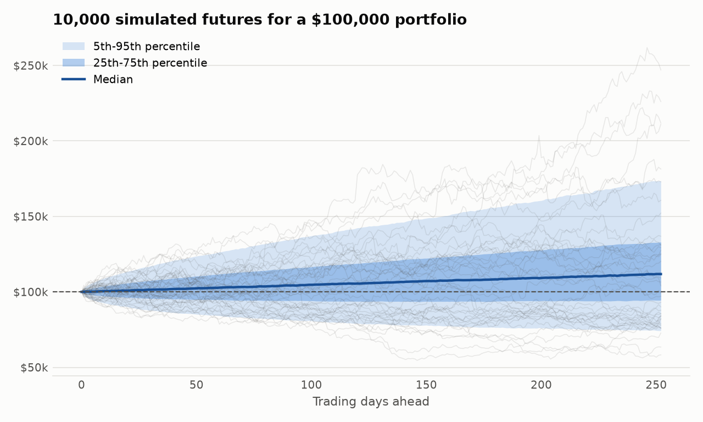
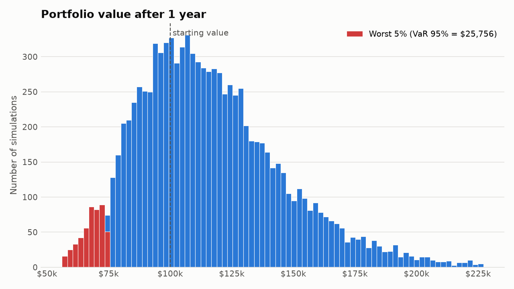
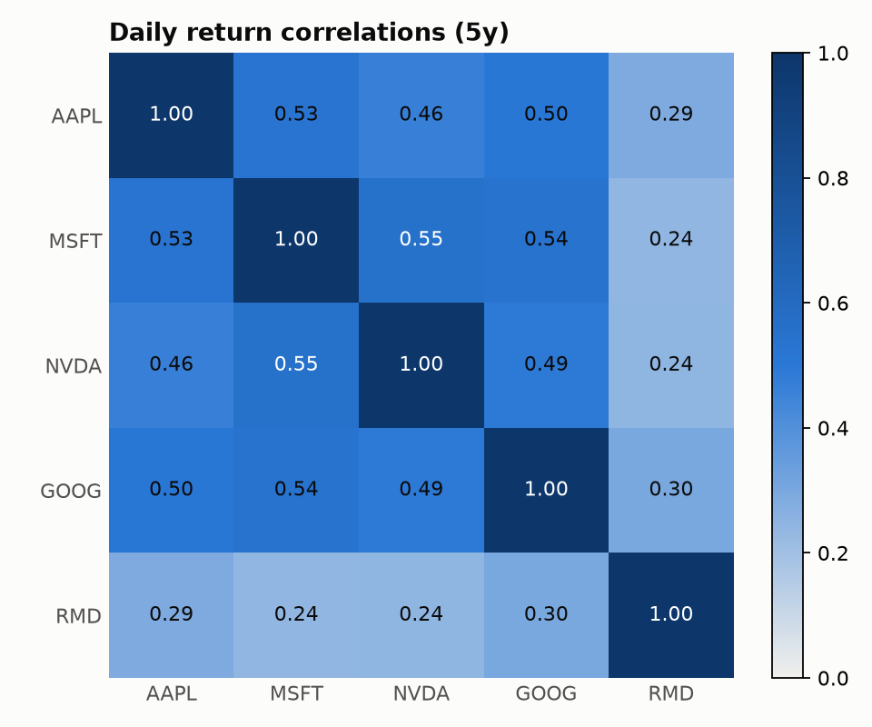
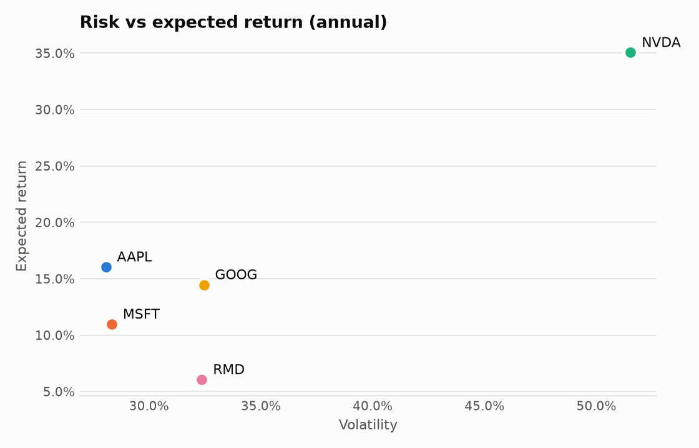

# Monte Carlo Portfolio Risk

Simulates 10,000 possible one-year futures for a 5-stock portfolio and measures the risk.

**Portfolio:** AAPL, MSFT, NVDA, GOOG, RMD — 20% each, $100,000 start, buy-and-hold.
**Data:** daily split-adjusted closes, 2021-11-11 → 2026-11-11 (`data/prices.csv`). Dividends not included.




| Correlations | Risk vs return |
|---|---|
|  |  |

## Method
1. **Log returns** from daily closes.
2. **Volatility** = std of daily returns × √252. **Correlations** from daily returns.
3. **Expected returns** = 50% historical + 50% an 8% long-run equity prior. Five years of
   history overstate future returns (NVDA's history implies 62%/yr), so they are shrunk.
4. **Simulation:** 10,000 paths × 252 days. Shocks are correlated via the Cholesky
   factor of the covariance matrix and drawn from a Student-t (5 d.o.f.) to produce
   fat tails — bigger crash days than a normal distribution allows.
5. **Risk metrics:** VaR & CVaR (95%/99%), probability of loss, max-drawdown distribution.

## Run
```bash
pip install -r requirements.txt
python mc_portfolio_risk.py            # uses data/prices.csv
python mc_portfolio_risk.py --yahoo    # fresh download (pip install yfinance)
```
```bash
python verify.py       # 16 independent checks (inputs, simulation, VaR/CVaR, seeds, model comparison)
python make_video.py   # 38s results clip -> output/monte_carlo_results.mp4 (needs ffmpeg)
```
Change `TICKERS`, `WEIGHTS`, `N_SIMS`, `HORIZON_DAYS`, `SHRINK`, `T_DOF` at the top of the script.

## Outputs (`output/`)
- `1_correlations.png`, `2_risk_return.png`, `3_simulated_paths.png`, `4_ending_value_distribution.png`
- `stock_estimates.csv`, `correlations.csv`, `risk_report.csv`

## Limitations / next steps
- Volatility and correlations are held constant; real markets have volatility clustering
  (try GARCH) and correlations that spike in crashes.
- Try historical bootstrap (resample real days) as a model-free comparison.
- Add rebalancing, weight optimization (efficient frontier), or stress scenarios.

*Educational project — not investment advice.*
